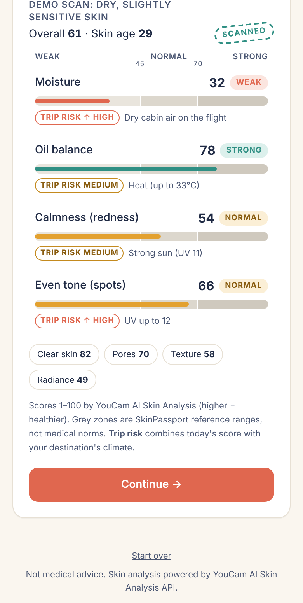
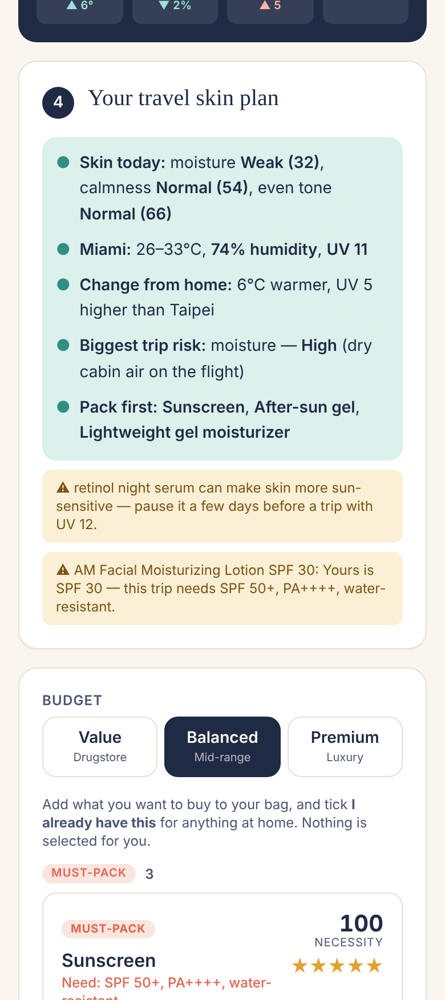
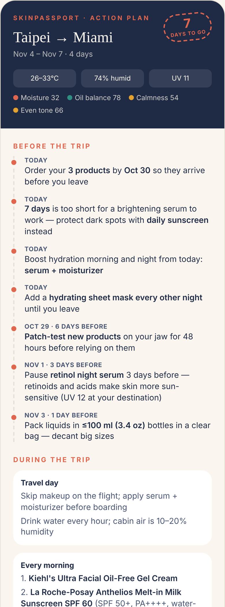

# SkinPassport: Geo-Adaptive Skincare Coach

**Your trip + your skin today = the right travel kit.**

SkinPassport plans your trip, scans your skin with the **YouCam AI Skin Analysis API** (9 travel-relevant scores + skin type), checks what's already on your shelf, and pulls the weather for your exact dates (temperature, humidity, UV index, air quality). It turns all of that into:

- an **InBody-style skin report**: each score in grey reference zones (Weak · Normal · Strong) plus a **trip risk** for your destination,
- a **Necessity Score (0–100)** with a Must-pack / Recommended / Nice-to-have tag for every product category,
- product picks from a **L'Oréal Groupe-first catalog** in three budgets, each explained through its **verified ingredients** ("Your Moisture is Weak (32) → contains Ceramides, which rebuild the skin barrier"),
- a **YouCam AI Skin Simulation** of your own face after the plan (before/after slider), improving only what your chosen products address,
- an **action plan** with a 3D passport stamp (**Well protected** once every must-pack is covered), **Before the trip** steps that adapt to how many days are left, and a visual **During the trip** routine with product photos, **saved as an image** to your phone.

> Demo highlight: the same dry-skin scan produces a completely different plan for **New York in winter** (ceramide cream, hydrating serum, lip repair, SPF 30) and **Miami in July** (SPF 50+ water-resistant sunscreen, after-sun gel, a light gel moisturizer instead of rich cream).


| Skin report + trip risk | Ingredient-based picks | Action plan (saved image) | Product page |
|---|---|---|---|
|  |  |  |  |

---

## How it works

**Landing page (`/`):** a MediaPipe face mesh turning in 3D, the name, one headline and Start. Returning users (with saved passports) go straight to My Passports.

**Navigation:** three tabs, **My SkinPassport · Skin analysis · Shopping cart**, as a bottom bar on phones and a left side rail on wide screens (hidden during the 4-step trip flow). Skin analysis shows the latest scan with "New scan" and "Plan a trip"; Shopping cart is the most recent passport's bag. Every page is responsive (two columns on wide screens).

The trip flow is four pages: **Set your trip → Scan your skin → Add your shelf → Get your plan**. Move back and forward freely (Back link or the progress bar) until the plan is generated; then the result is locked.

1. **Set your trip**: *From* and *To* (country first, then city, with autocomplete; "Use my location"), an animated flight map, dates, transport (multi-select) and activity tags that flow into free-text notes. `/api/weather` returns:
   - **Predicted weather** when the whole trip is within 16 days (Open-Meteo / OpenWeather forecast),
   - **Typical for these dates** further out: last year's weather for the same dates from the Open-Meteo archive (UV is estimated from latitude and season if the archive has none, and labelled "est."),
   - plus the **current climate at home**, so the plan can react to the change ("25°C colder and 38 pts drier than Taipei").
2. **Scan your skin**: a passport-style scanner: MediaPipe Face Landmarker tracks 478 face points live in the browser and auto-captures when the face is steady; while YouCam analyzes, the photo becomes a rotating 3D mesh with a checklist tied to the real request status. We request the **9 SD concerns our products can address** (moisture, oil, redness, spots, acne, pores, texture, radiance, fine lines) plus **skin type** (whole face, T-zone and U-zone). Firmness, the eye area and eyelid shape are left out on purpose: the plan has no product for them. Skin type changes the plan in four ways: product texture (dry → rich creams, oily/combination → light gels), zone advice for combination skin (gel on the T-zone, cream on the cheeks), gentle care first for Redness types (soothing becomes a must-pack, fragrance-free ranks higher), and it appears in the summary, the product reasons and on the passport. The report overlays **YouCam's per-concern masks** on the photo, shows the 4 travel-sensitive scores first and the other 4 grouped, each InBody-style: grey zones **Weak <45 · Normal 45–69 · Strong ≥70** (SkinPassport reference ranges, not medical norms) and a **trip risk** (Low / Medium / High) that combines today's score with the destination.
   YouCam flow: `POST /s2s/v2.0/file/skin-analysis` → upload to the presigned URL → `POST /s2s/v2.0/task/skin-analysis` → poll `GET /s2s/v2.0/task/skin-analysis/{id}`. If an account rejects `skin_type`, the app retries with the 9 scores.
3. **Add your shelf (optional)**: search our catalog or **Open Beauty Facts** (any brand), or add a product by name. The app guesses the type and SPF from the name and flags retinoids/acids. Owned products:
   - cover a category ("Packed from home"), after a **spec check** (e.g. "Yours is SPF 30, this trip needs SPF 50+, water-resistant"),
   - make similar picks from the same brands rank higher,
   - leave the remaining needs as the **complementary** picks,
   - trigger warnings (retinol + strong sun → pause 3 days before, leave it at home).
4. **Get your plan**: 14 product types, including targeted care tied to the trip: **blemish care** (acne + heat/humidity), **pore-refining serum** (pores + heat/humidity), **gentle exfoliant** (texture + dry air, pulled down by strong sun) and **line-smoothing serum** (fine lines + dry/cold air; retinol ranks lower on sunny trips). **Cleansers are picked by concern**: 2% salicylic acid for acne, foaming gel for oil and pores, hydrating for dry or reactive skin. Each card shows which of your measures it **Targets** and any **percentage the brand states** (e.g. Niacinamide 10% · High); higher is not always better: reactive skin and strong sun favour gentler strengths. Ranking gives the most points to a **brand you already use**, then to **another brand from the same group** (L'Oréal Groupe, Estée Lauder Companies, Shiseido, Unilever, P&G, Kenvue, Beiersdorf, Galderma, Pierre Fabre, Amorepacific, Edgewell; see `shop/brandGroups.ts`). A **By concern** view lists the best products for each measure. Then: bullet summary with **bold** key facts. Skin, weather and risk come from the server (template, or rewritten by Claude); **Pack first / In your bag / Already on your shelf** update live as you pick. Then one list grouped by tag. Each card shows the product for the chosen budget (Value / Balanced / Premium), trending ingredient badges, **ingredient-based reasons**, cautions, "+ Bag" and "I already have this". Nothing is pre-selected.
5. **Action plan** (`/plan`), built from the bag + what you have:
   - **Before the trip** adapts to the days left (e.g. a vitamin C serum is only suggested with 3+ weeks to go; otherwise "too short, rely on sunscreen"; order-by date; patch test; pause actives),
   - **Your skin after this plan** (YouCam AI Skin Simulation): the selfie is cropped around the face in the browser (the API needs the face to fill 60% of the width), then `POST /s2s/v2.0/task/skin-simulation` with an intensity per concern. Intensities come from `engine/simulation.ts`: only concerns that are not already Strong **and** that a product in your bag or on your shelf addresses, scaled by how weak the score is, capped at 0.6 (YouCam's "balanced" range); brightening only counts with 3+ weeks to go, and the eye area is never simulated because no product targets it. The result is shown as a before/after slider and becomes the photo on the passport page,
   - a tilted 3D passport page stamped **Well protected** (all must-packs covered) or **Scan passed** (with what is still missing),
   - **During the trip**: travel day, every morning, every night and reminders as icon + product-photo tiles with short labels.
   "Save as image" exports a phone-size PNG (share sheet on mobile → Save Image).

6. **My passports** (`/profile`): every finished plan is saved **on this device** (IndexedDB, nothing on a server), named "scan date · destination" by default and renamable. Each passport reopens the locked plan and action plan and shows how the core scores changed since the previous scan.
7. **Check a product** (inside each passport): type any product name. We find its ingredient list in this order:
   1. our verified catalog,
   2. **Open Beauty Facts** (open data),
   3. a **Claude agent with the web search tool** that must copy the list from a page it actually found; any source URL that didn't come back from the search is rejected,
   4. otherwise the user pastes the list.
   A deterministic parser (`engine/inci.ts`) maps the INCI list to known ingredients (synonyms such as Sodium Hyaluronate → Hyaluronic Acid), reads percentages from the name, SPF and fragrance, and guesses the product type (editable). `engine/productCheck.ts` then scores it with the same rules as our picks and gives one verdict: **Swap in** (fits as well as or better than our pick), **Adds to your plan**, **Not for this trip** (e.g. SPF too low, retinoid with strong sun) or **Not needed now** (e.g. a brightening serum 10 days out), with the type's necessity score and our pick side by side. Swap or add updates the passport's bag and action plan.

### Engine (`src/lib/engine/`, pure and unit-tested)

| File | What it does |
|---|---|
| `necessity.ts` | Skin concern levels × climate stress (UV with snow/water reflection, dry air, humidity, cold, heat, pollution, change from home, transport) → Necessity Score + tag; drops long-term brightening when the trip is under 3 weeks away |
| `report.ts` | Bands (Weak/Normal/Strong) and trip risk with its main reason |
| `ingredients.ts` | Ingredient knowledge base in cosmetic language (what each helps with, trending flag, cautions) |
| `reasons.ts` | Matches a product's **verified** ingredients to the user's weakest scores and the destination |
| `recommend.ts` | One pick per budget tier, owned-product spec checks, multi-use de-duplication |
| `actionPlan.ts` | Before the trip / During the trip (structured steps with icons and products) |
| `concentration.ts` | Stated percentages only; usual range per active (e.g. niacinamide 2–5%, salicylic acid 0.5–2%); strength × skin type × sun in ranking |
| `skinType.ts` | Skin type traits, zone advice, which cleanser kind fits |
| `simulation.ts` | Which concerns to simulate and how strongly, from what the user chose |
| `inci.ts` | Ingredient-list parser: known ingredients and synonyms, stated %, SPF, fragrance, product type |
| `productCheck.ts` | Scores any product against a saved plan: Swap in / Adds / Not for this trip / Not needed now |
| `summary.ts` | Template bullet summary + live packing bullets |

### Catalog (`src/lib/shop/catalog.ts`)

33 products, 27 from **L'Oréal Groupe** brands (CeraVe, La Roche-Posay, Kiehl's, Vichy, SkinCeuticals, Lancôme, L'Oréal Paris, Garnier) and 6 others where L'Oréal had no fit or no stated percentage (The Ordinary, Paula's Choice, Neutrogena, Sun Bum). Every ingredient we mention was checked against the product's published INCI list (source link on each product page); brand claims such as "water-resistant 80 minutes" were checked on retailer pages. Descriptions are written in our own words. The `ShopProvider` interface lets you swap in a live store API, see [docs/shop-api-survey.md](docs/shop-api-survey.md).

## Tech stack

| Layer | Technology |
|---|---|
| Frontend | Next.js 16 (App Router) + React 19 + TypeScript, Tailwind CSS v4, mobile-first |
| Backend | Next.js Route Handlers (`src/app/api/*`), all API keys stay on the server |
| Skin AI | YouCam AI Skin Analysis API (9 scores + skin type, masks) and YouCam AI Skin Simulation API |
| Weather | Open-Meteo (default, no key) or OpenWeather |
| LLM | Anthropic Claude (optional) |
| Map | d3-geo + world-atlas (Natural Earth), animated in SVG |
| Face scan | MediaPipe Face Landmarker (in-browser, 478 3D points) + YouCam masks |
| Product photos | Open Beauty Facts (CC BY-SA 3.0), backgrounds removed with @imgly/background-removal-node |
| Image export | html-to-image (action plan → PNG) |
| Tests | Vitest (`src/lib/**/__tests__`) |

## Project structure

```
src/
  app/
    page.tsx                 # landing page (3D face + Start)
    trip/page.tsx            # the 4-step flow (Trip → Scan → Shelf → Plan)
    plan/page.tsx            # action plan + save as image
    product/[id]/page.tsx    # product detail pages
    profile/page.tsx         # My passports (saved on this device) + Check a product
    skin/page.tsx            # Skin analysis tab (latest scan)
    cart/page.tsx            # Shopping cart tab (most recent passport's bag)
    api/skin/analyze         # YouCam: upload + create task
    api/skin/status          # YouCam: poll task
    api/skin/simulate        # YouCam AI Skin Simulation: create (POST) and poll (GET)
    api/places               # country-filtered city autocomplete
    api/weather              # trip forecast, home climate, or demo scenario
    api/plan                 # engine + report + picks + summary
    api/products/search      # catalog + Open Beauty Facts search for "My shelf"
    api/products/lookup      # Check a product: catalog → Open Beauty Facts → Claude web search
    api/health               # which integrations are live
  components/                # CameraCapture, ScanResult, ShelfStep, Results, ActionPlanView, ProductView…
  lib/
    engine/                  # necessity, report, ingredients, reasons, recommend, actionPlan, summary
    server/                  # youcam.ts, weather.ts, llm.ts (server-only)
    shop/                    # catalog.ts, provider.ts
    places.ts                # countries + popular cities for instant autocomplete
    shelf.ts                 # guess type / SPF / retinoids for owned products
    store.ts                 # client state shared across pages (sessionStorage)
docs/                        # architecture, screenshots, shop API survey
```

## Run it locally

Requires Node.js 20+.

```bash
npm install
cp .env.example .env.local   # add YOUCAM_API_KEY (others optional)
npm run dev                  # http://localhost:3000
npm test                     # engine unit tests
npm run setup:assets         # one-time: product photos + face-scan model (needs internet, ~5 min)
```

`setup:assets` downloads front photos from Open Beauty Facts, removes the backgrounds on your machine, and saves them to `public/products/`. It also downloads the MediaPipe face model to `public/models/`. Products without a photo keep the illustrated pack shot, and the app loads the face model from Google's CDN if it isn't saved locally.

Every integration has a fallback, so the app runs with **no keys at all**: demo skin scan, Open-Meteo weather, template coach note. Set `MOCK_YOUCAM=1` to film the demo without spending YouCam units.

## Limitations and next steps

- Product prices are estimates; the next step is a live Shop API (Shopify Storefront or Amazon Creators API).
- Trips more than 16 days out use last year's weather; a multi-year climate average would be steadier.
- Calendar sync (Google Calendar) to detect upcoming trips automatically.
- Live prices from a store API.
- YouCam Virtual Try-On for the recommended products.

## Credits

- Ingredient lists checked on [Skinsort](https://skinsort.com) and retailer pages (links on each product page).
- Product photos: [Open Beauty Facts](https://world.openbeautyfacts.org) contributors, [CC BY-SA 3.0](https://creativecommons.org/licenses/by-sa/3.0/); edited (backgrounds removed). Full list in [docs/IMAGE_CREDITS.md](docs/IMAGE_CREDITS.md).
- Map data: Natural Earth via world-atlas.
- Landing page face: [MediaPipe canonical face model](https://github.com/google-ai-edge/mediapipe/blob/master/mediapipe/modules/face_geometry/data/canonical_face_model.obj), Copyright Google LLC, Apache License 2.0 (`src/lib/canonicalFace.ts`).

## License

Code: MIT (see [LICENSE](LICENSE)). Product photos: CC BY-SA 3.0. Face model: Apache 2.0.

Not medical advice.
