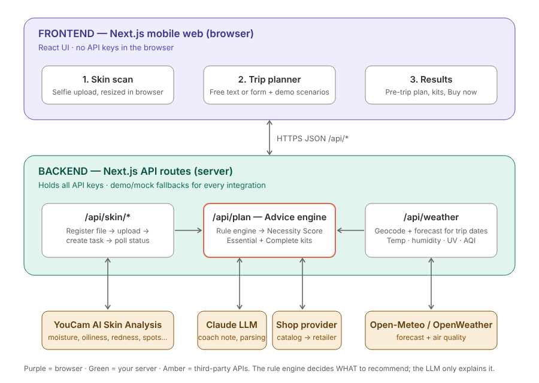
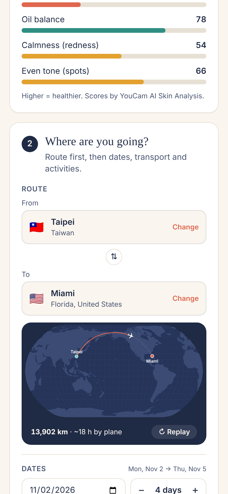
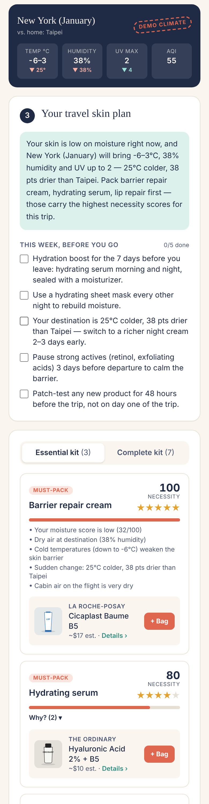
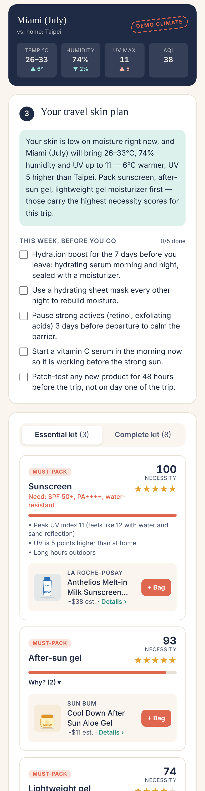
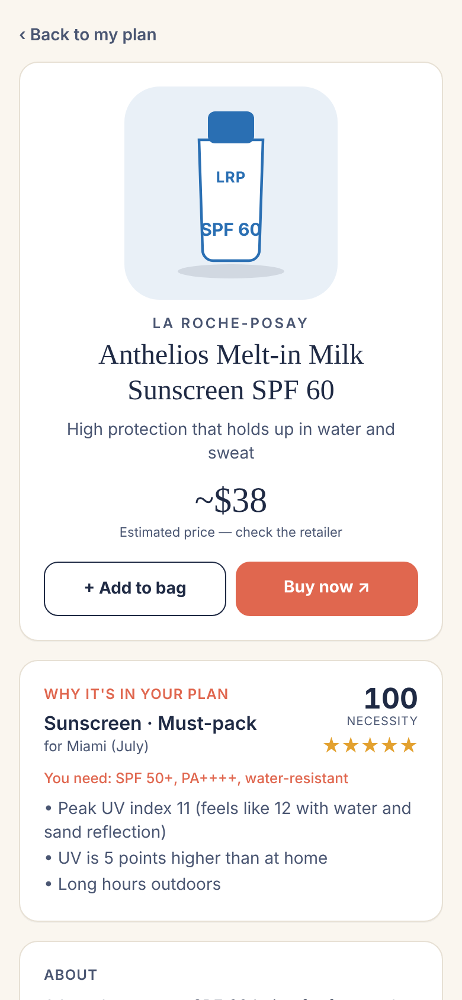

# SkinPassport — Geo-Adaptive Skincare Coach

**Your skin today + your destination's climate = the right travel kit.**

SkinPassport scans your skin with the **YouCam AI Skin Analysis API**, pulls the weather forecast for your trip (temperature, humidity, UV index, air quality), and turns both into:

- a **pre-trip routine** for the days before you leave ("your skin is dry — hydration boost this week"),
- a **Necessity Score (0–100)** and star rating for every product category,
- an **Essential kit** (must-pack only) and a **Complete kit**, each with a Buy now link and an estimated cart total.

> Demo highlight: the same dry-skin scan produces a completely different cart for **New York in winter** (ceramide barrier cream, hydrating serum, lip repair, SPF 30) and **Miami in July** (SPF 60 water-resistant sunscreen, after-sun gel, a light gel moisturizer instead of rich cream).



| Route + flight map | New York, dry winter | Miami, high UV | Product page |
|---|---|---|---|
|  |  |  |  |

---

## How it works

1. **Skin scan** — a passport-style scanner: the in-app camera tracks 478 face points live with **MediaPipe Face Landmarker** (in the browser), guides the user into the oval and auto-captures when they hold still. While YouCam analyzes, the photo turns into a rotating 3D face mesh with a checklist that follows the real request status. The result shows **YouCam's per-concern masks** over the photo — tap Moisture, Redness or Spots to see where YouCam found it. Uploading a photo works too. The browser crops and resizes the selfie and sends it to `/api/skin/analyze`. The server registers the file with YouCam (`POST /s2s/v2.0/file/skin-analysis`), uploads the bytes to the presigned URL, starts a task (`POST /s2s/v2.0/task/skin-analysis`) and the browser polls `/api/skin/status` until the task succeeds. We use the SD concerns `moisture, oiliness, redness, age_spot, acne, pore, texture, radiance` (scores 1–100, higher = healthier).
2. **Trip** — in this order:
   - **Route:** *From* and *To*, each picked **country first, then city** with type-ahead autocomplete (`/api/places`: instant local matches + live Open-Meteo geocoding). "Use my location" fills *From*. A world map animates a plane (or train, car, ship) along the great-circle route and shows distance and travel time.
   - **Dates:** start date + number of days.
   - **Getting there:** multi-select plane, train, car, bus, subway, ship.
   - **Activities & special notes (optional):** multi-select tags (beach, skiing, hiking, festival…). Tapping a tag also writes it into the notes box, which the user can edit; notes are passed to the coach note.
   `/api/weather` returns the forecast for the trip window **and the current climate at home**, so the engine can react to the change (e.g. "25°C colder and 38 pts drier than Taipei").
3. **Advice engine** (`src/lib/engine/necessity.ts`) — a transparent rule engine converts skin scores into concern levels (dryness, oil, sensitivity, spots) and the climate into stress factors (UV with snow/water reflection, dry air, humidity, cold, heat, pollution). Each category gets a Necessity Score and a tier:

   | Score | Tier | Kit |
   |---|---|---|
   | 70–100 | Must-pack | Essential + Complete |
   | 50–69 | Recommended | Complete |
   | 35–49 | Nice to have | Complete |
   | < 35 | Skip | — |

   The engine also scores the **change from home**: big temperature drops, drier air or a UV jump raise barrier cream, hydration, lip care and sunscreen. Flights raise the face-mist score more than trains or buses. The sunscreen spec is derived from effective UV: SPF 50+ / PA++++ when UV ≥ 8, water-resistant for beach, ski and outdoor trips.
4. **Shop provider** (`src/lib/shop/`) — picks the best-fitting product per category **for each budget tier (Value / Balanced / Premium)** (SPF requirement, water resistance, sensitive-skin friendly, price). The MVP uses a curated catalog with retailer links; the `ShopProvider` interface lets you swap in a real store API. See [docs/shop-api-survey.md](docs/shop-api-survey.md).
   On the results, users switch budget tiers instantly and tick **"I already have this"**: the item moves to "packed from home" (with a reminder of the spec it must meet, e.g. SPF 50+ water-resistant) and drops out of the to-buy total.
5. **Product pages** (`/product/[id]`, statically generated) — background-removed product photo from Open Beauty Facts (illustrated fallback), description, key ingredients, how to use, carry-on tip, "why it's in your plan" (score, tier and reasons from your plan), alternatives, add to bag and Buy now. A bag sheet keeps picked items and an estimated total across pages.
6. **Coach note** — Claude writes a 2–3 sentence explanation from the engine's output. The LLM never decides what to recommend, so results are stable and explainable.

## Tech stack

| Layer | Technology |
|---|---|
| Frontend | Next.js 16 (App Router) + React 19 + TypeScript, Tailwind CSS v4, mobile-first |
| Backend | Next.js Route Handlers (`src/app/api/*`) — all API keys stay on the server |
| Skin AI | YouCam AI Skin Analysis API |
| Weather | Open-Meteo (default, no key) or OpenWeather |
| LLM | Anthropic Claude (optional) |
| Map | d3-geo + world-atlas (Natural Earth), animated in SVG |
| Face scan | MediaPipe Face Landmarker (in-browser, 478 3D points) + YouCam masks |
| Product photos | Open Beauty Facts (CC BY-SA 3.0), backgrounds removed with @imgly/background-removal-node |
| Tests | Vitest (`src/lib/**/__tests__`) |

## Project structure

```
src/
  app/
    page.tsx                 # mobile UI (3 steps)
    product/[id]/page.tsx    # product detail pages
    api/skin/analyze         # YouCam: upload + create task
    api/skin/status          # YouCam: poll task
    api/places               # country-filtered city autocomplete
    api/weather              # trip forecast, home climate, or demo scenario
    api/plan                 # engine + kits + coach note
    api/health               # which integrations are live
  components/                # CameraCapture, LocationPicker, TripMap, Results, ProductView, Bag…
  lib/
    engine/                  # necessity.ts, kits.ts, scenarios.ts (pure, tested)
    server/                  # youcam.ts, weather.ts, llm.ts (server-only)
    shop/                    # catalog.ts, provider.ts
    places.ts                # countries + popular cities for instant autocomplete
    store.ts                 # client state shared across pages (sessionStorage)
docs/                        # architecture, screenshots, shop API survey
```

## Run it locally

Requires Node.js 20+.

```bash
npm install
cp .env.example .env.local   # add YOUCAM_API_KEY (others optional)
npm run dev                  # http://localhost:3000
npm test                     # engine unit tests
npm run setup:assets         # one-time: product photos + face-scan model (needs internet, ~5 min)
```

`setup:assets` downloads front photos from Open Beauty Facts, removes the backgrounds on your machine, and saves them to `public/products/`. It also downloads the MediaPipe face model to `public/models/`. Products without a photo keep the illustrated pack shot, and the app loads the face model from Google's CDN if it isn't saved locally.

Every integration has a fallback, so the app runs with **no keys at all**: demo skin scan, Open-Meteo weather, template coach note. Set `MOCK_YOUCAM=1` to film the demo without spending YouCam units.

## Limitations and next steps

- Product prices are estimates; the next step is a live Shop API (Shopify Storefront or Amazon Creators API).
- Forecasts reach 16 days ahead (5 days with OpenWeather); later trips should use climate averages.
- Calendar sync (Google Calendar) to detect upcoming trips automatically.
- Live prices from a store API.
- YouCam Virtual Try-On for the recommended products.

## Credits

- Product photos: [Open Beauty Facts](https://world.openbeautyfacts.org) contributors, [CC BY-SA 3.0](https://creativecommons.org/licenses/by-sa/3.0/); edited (backgrounds removed). Full list in [docs/IMAGE_CREDITS.md](docs/IMAGE_CREDITS.md).
- Map data: Natural Earth via world-atlas.

Not medical advice.
